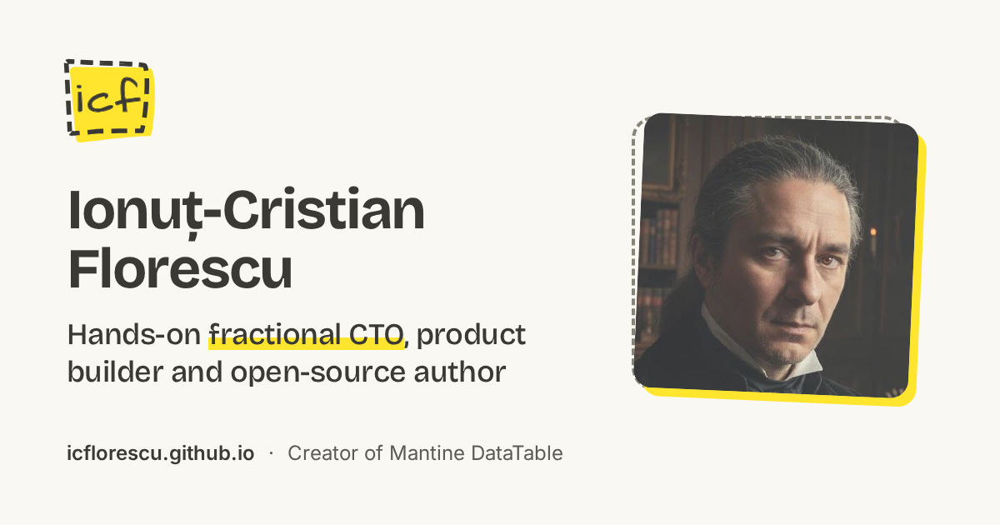
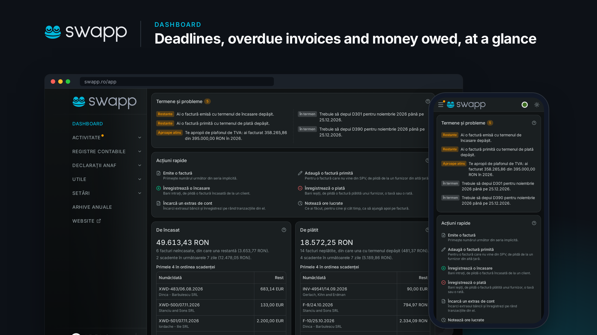

# Ionuț-Cristian Florescu (aka icflorescu)

[](https://icflorescu.github.io/)

This is the source of [my personal website](https://icflorescu.github.io/). I'm Ionuț-Cristian Florescu, a hands-on fractional CTO, product builder and open-source author from Bucharest, Romania. I take software products from a blank repo to production, and stay to run them for a decade. I still write production code; I've also learned which code isn't worth writing.

## What I offer

- **Fractional CTO & technical partner.** For early-stage products that need a senior person to own the technical side: architecture, code, infrastructure, data and day-to-day operations. I treat software as a business asset, not a ticket queue.
- **Profit-share or equity partnerships.** If the business side is covered, I'll own the technical side for a share of the profits instead of a fee, as I did with [LeasingSH.ro](https://www.leasingsh.ro/), an online automotive marketplace, for 13 years. Equity works too, but profit is what's real.
- **Selected hands-on work.** TypeScript, React, TanStack Start / Next.js, Node.js / Bun and PostgreSQL. Data-rich interfaces are home turf: I wrote [Mantine DataTable](https://icflorescu.github.io/mantine-datatable/), used by teams at Microsoft and Namecheap.

I've been building for the web since 1998: insurance platforms, marketplaces, tax software and a fair amount of open source, including [Mantine ContextMenu](https://icflorescu.github.io/mantine-contextmenu/) and [tRPC-SvelteKit](https://icflorescu.github.io/trpc-sveltekit/).

## My own product — swapp.ro

[](https://swapp.ro/)

[Swapp.ro](https://swapp.ro/) is invoicing and single-entry accounting for Romanian freelancers (PFA, ÎI, PFI) who aren't VAT-registered. You record each transaction once, and everything that follows from it is worked out for you:

- invoices sent through ANAF's e-Factura, with supplier invoices collected in the background;
- the mandatory ledgers, always up to date, and the figures for the D212, D390 and D301 returns, with their due dates;
- help on every screen that explains the tax rule and cites the article of law;
- an [MCP server](https://swapp.ro/conector-ai) for Claude, ChatGPT, Cursor and Codex, which reads your books, logs your hours and draws up invoices, and nothing it does reaches ANAF;
- accounting, not just invoicing, at a truly affordable price: a fraction of what comparable apps charge.

I built it in 2021 for my own books, then rebuilt it from scratch in 2026 so other freelancers can use it too. Solo, in five months: product, design, code and operations. It's been live since October 2026, and I trust it with my own books.

## Get in touch

Building something? [Book a call on cal.com](https://cal.com/icflorescu), or find my email on [the website](https://icflorescu.github.io/#contact). Tell me about your project, and mention that you found me here: I get quite a few messages, and it helps me prioritise yours.

You can also find me on [GitHub](https://github.com/icflorescu), [LinkedIn](https://www.linkedin.com/in/icflorescu/) and [Bluesky](https://bsky.app/profile/icflorescu.bsky.social), read [my résumé](https://github.com/icflorescu/icflorescu/blob/main/ionut-cristian-florescu--resume.pdf), or [sponsor my open-source work](https://github.com/sponsors/icflorescu).

---

## About this repository

The site is a single static page built with [Astro](https://astro.build/). It also gives the whole `icflorescu.github.io` host, including the project docs sites under it ([Mantine DataTable](https://icflorescu.github.io/mantine-datatable/), [Mantine ContextMenu](https://icflorescu.github.io/mantine-contextmenu/), [tRPC-SvelteKit](https://icflorescu.github.io/trpc-sveltekit/), …), a proper favicon, site name and `robots.txt`.

### Requirements

[Bun](https://bun.sh/) 1.4 or newer. Dependencies are pinned to exact versions (see `bunfig.toml`).

### Develop

```sh
bun install
bun run dev        # http://localhost:4321
```

| Script                    | What it does                                                                        |
| ------------------------- | ----------------------------------------------------------------------------------- |
| `bun run dev`             | Starts the dev server                                                               |
| `bun run build`           | Builds the static site into `dist/`                                                 |
| `bun run preview`         | Serves the built site locally                                                       |
| `bun run check`           | Type-checks (`astro check`) and lints/format-checks ([Biome](https://biomejs.dev/)) |
| `bun run format`          | Applies Biome's formatting and safe fixes                                           |
| `bun run generate-images` | Regenerates the favicon set and the social image in `public/`                       |

#### Live figures

The GitHub star and npm download counts on the page are fetched at build time (`src/data/stats.ts`). If the APIs can't be reached, the build falls back to a dated snapshot and says so on the page. Set `GITHUB_TOKEN` to avoid GitHub's anonymous rate limit, or `STATS_OFFLINE=1` to skip the requests entirely.

#### Content

All the copy is in the components under `src/components/`, one per section. Links, profiles and contact details are in `src/data/site.ts`. Project screenshots are in `src/assets/screens/` and are converted to WebP and resized at build time.

The same content is also published as Markdown for LLMs and AI agents at [`/llms.txt`](https://icflorescu.github.io/llms.txt), generated by `src/pages/llms.txt.ts`. Its figures and links come from the same data, but its prose is written separately (in the third person), so **when you change the copy, update `llms.txt.ts` to match**.

#### The mark and the icons

The "icf" mark lives in `src/assets/mark/` (a light and a dark variant). The page loads both as cached image files and shows the one matching the color scheme. The browser-tab icon is a simplified variant built from the light drawing, with dark letters in both schemes. After changing the mark or the social-image design in `scripts/generate-images.ts`, run:

```sh
bunx playwright install chromium   # once
bun run generate-images
```

and commit the regenerated files in `public/`: `icon.svg`, `favicon.ico`, `apple-touch-icon.png`, `icon-192.png`, `icon-512.png`, `icon-maskable-512.png` and `og.png`.

### Deploy

`.github/workflows/deploy.yml` builds and deploys the site to GitHub Pages on every push to `main`, weekly (to refresh the figures), and on demand from the Actions tab. One-time setup in the repository settings: **Settings → Pages → Build and deployment → Source: GitHub Actions**.

Actions are pinned to commit SHAs, with the version in a comment.

### Paths: don't clash with the project sites

GitHub Pages serves every repository of mine that has Pages enabled at `icflorescu.github.io/<repo-name>/`, so this site must never create a file or folder named after one of my repositories. It only uses `/`, the icon and meta files at the root (`favicon.ico`, `icon.svg`, `apple-touch-icon.png`, `icon-*.png`, `site.webmanifest`, `og.png`, `robots.txt`, `sitemap.xml`, `llms.txt`) and `/_astro/` for hashed build assets.

Because crawlers only read `robots.txt` at the root of a host, this site's `robots.txt` also lists the project docs sitemaps (`src/data/site.ts` → `PROJECT_SITEMAPS`).

## License

The source code is [MIT-licensed](LICENSE). The site's content (the text, my photo, the "icf" mark and its icons, the social image and the product screenshots) is © Ionuț-Cristian Florescu, all rights reserved.
